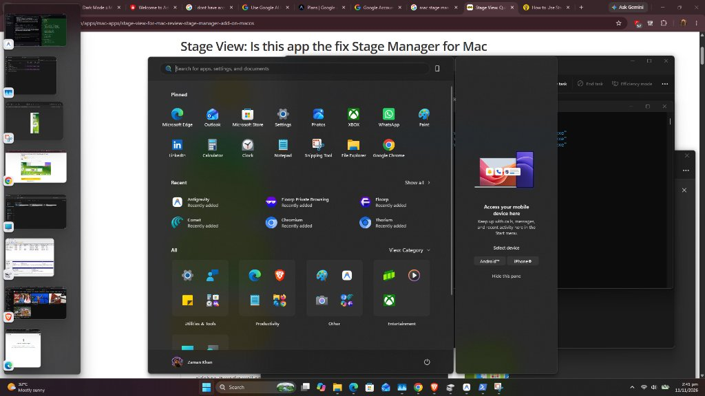
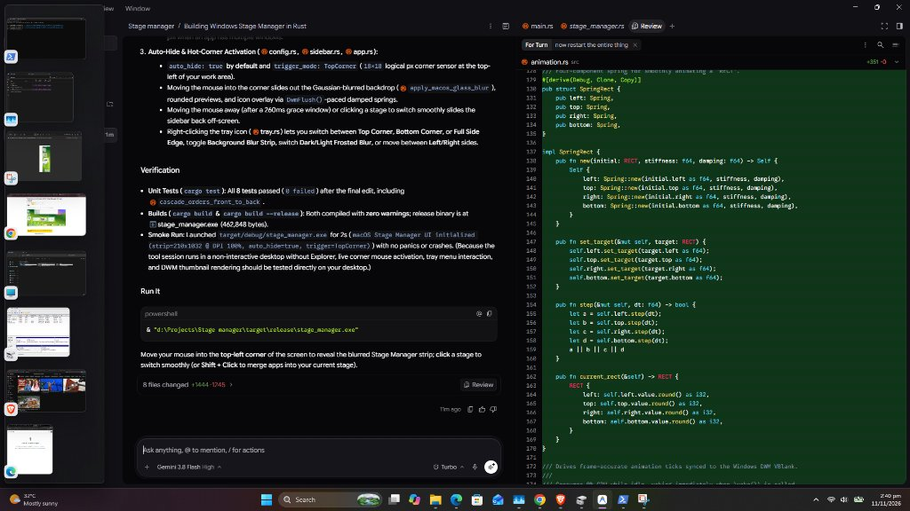

<p align="center">
  
</p>

<p align="center">
  <a href="../../actions/workflows/release.yml"></a>
  <a href="LICENSE"></a>
  <a href="https://www.microsoft.com/windows"></a>
  <a href="https://www.rust-lang.org/"></a>
  <a href="../../releases/latest"></a>
</p>

<h1 align="center">Stage Manager for Windows</h1>

<p align="center">
  <strong>A native, ultra-lightweight macOS-style Stage Manager for Windows 10 &amp; 11 written in Rust.</strong><br>
  Real-time GPU previews via DWM, 60/120Hz VSync spring physics, multi-monitor isolation, and virtual desktop integration — with zero Electron or screenshot polling overhead.
</p>

<p align="center">
  <a href="#-quickstart-clone--run-in-60-seconds">Quickstart</a> •
  <a href="#-screenshots">Screenshots</a> •
  <a href="#-features">Features</a> •
  <a href="#-how-it-works">How It Works</a> •
  <a href="#-controls--shortcuts">Shortcuts</a> •
  <a href="#-documentation">Docs</a>
</p>

---

## ⚡ Quickstart: Clone & Run in 60 Seconds

Anyone with Windows 10 or 11 can clone and run Stage Manager immediately.

### 1. Prerequisites (Skip if you already have Git and Rust)
Open **PowerShell** and run:
```powershell
winget install --id Git.Git -e --source winget; winget install --id Rustlang.Rustup -e --source winget
```
*(Restart PowerShell after install so `git` and `cargo` are available in your path)*

### 2. Clone & Run
```powershell
# Clone the repository
git clone https://github.com/fruitsaladwindowsai-zammy/Stage-manager-Rust.git
cd Stage-manager-Rust

# Run immediately in release mode
cargo run --release
```

Move your cursor to the **left edge of your screen** — Stage Manager slides out instantly!

### 3. Build & Install Permanently (Optional)
To create the standalone Windows installer and install Stage Manager into your Start Menu and Windows startup:
```powershell
# Build application and installer
cargo build --release --bin stage_manager
$env:STAGE_MANAGER_EMBED_PATH = "target\release\stage_manager.exe"
cargo build --release --bin StageManagerSetup

# Run installer
.\target\release\StageManagerSetup.exe
```

> Prefer a prebuilt executable? Grab **`StageManagerSetup.exe`** directly from the [**Releases**](../../releases/latest) page!

---

## 📸 Screenshots

<p align="center">
  
  <em>Real-time GPU window previews organized along the screen edge with Start Menu active</em>
</p>

<p align="center">
  
  <em>Active coding stage with neighboring stages curved inward and auto-hidden when working</em>
</p>

---

## ✨ Features

- **Live GPU Window Previews (`DwmRegisterThumbnail`)** — Direct hardware compositing links with rounded corners. Zero CPU screenshot polling.
- **Auto-Hide & Smooth Spring Physics** — Damped spring physics (`f64`) synced to Windows DWM VSync (`DwmFlush`) for seamless 60Hz and 120Hz high-refresh displays.
- **macOS Curved Ribbon Wave** — The hovered stage pops forward toward you while neighboring stages bend gently inward.
- **Pure Borderless Stage Icons** — Clean, natural application icons rendered directly onto the stage without unwanted boxes, shadows, or borders.
- **Grouped App Hover Expansion** — Multi-window applications fan out horizontally on hover with individual app icons so you can pick any specific window in one click.
- **Infinite Carousel Scroll** — Seamlessly scroll through unlimited open applications; hovering the top or bottom edge wraps indefinitely in either direction.
- **Multi-Monitor Span Isolation** — Each connected monitor gets its own independent strip, trigger zone, and DPI scaling. Cards, blur layers, and icons are clamped strictly to display boundaries, preventing spillover or splitting in wallpaper span mode.
- **Virtual Desktop Isolation** — Windows are tracked per Virtual Desktop GUID using `IVirtualDesktopManager`. Switching virtual desktops (`Win + Ctrl + Left/Right`) starts a clean workspace.
- **System Tray App & Startup Boot** — Lives silently in the notification area with right-click configuration and a toggle for **Run at Windows Startup**.
- **Automated Prerequisites Verification** — Standalone installer automatically validates OS version, 64-bit architecture, and DWM composition before installing.
- **Tiny Footprint** — Compiles to a self-contained ~550 KB executable using under 20MB of RAM.

---

## 🔍 How It Works

```
                                    +-----------------------+
                                    |   Windows OS / DWM    |
                                    +-----------+-----------+
                                                |
                 +------------------------------+------------------------------+
                 | (WinEvents: Focus, Move, Min)| (DwmFlush VSync Ticks)        | (IVirtualDesktopManager)
                 v                              v                              v
        +------------------+           +------------------+           +------------------+
        |  WindowTracker   |           | Animation / Clock|           |  Desktop Tracker |
        +--------+---------+           +--------+---------+           +--------+---------+
                 |                              |                              |
                 +----------------------+       |       +----------------------+
                                        |       |       |
                                        v       v       v
                                  +---------------------------+
                                  |    App Coordinator        |
                                  | Map<(Desktop, Mon), State>|
                                  +-------------+-------------+
                                                |
                 +------------------------------+------------------------------+
                 |                                                             |
                 v                                                             v
        +------------------+                                          +------------------+
        |   StageManager   |                                          |  Sidebar Window  |
        |  Group & Switch  |                                          | Direct2D Render  |
        +------------------+                                          +------------------+
```

1. **Window Discovery & Filtering:** `WindowTracker` enumerates top-level application windows while filtering out tooltips, cloaked windows, and system overlays. It listens for WinEvents (`EVENT_SYSTEM_FOREGROUND`, `EVENT_OBJECT_LOCATIONCHANGE`) to keep state updated in real-time.
2. **Virtual Desktop & Monitor Routing:** Windows are sorted into independent workspaces keyed by `(VirtualDesktopId, MonitorHandle)`. Windows on Monitor 2 or Desktop 2 never bleed into Monitor 1.
3. **Physics-Driven Layout:** Moving the cursor to the screen edge activates an auto-hide spring. When hovering over multi-window stages, an `expand_t` spring smoothly fans out window preview cards horizontally.
4. **Rendering & Compositing:**
   - **Thumbnails:** Handled directly by Windows DWM via `DwmUpdateThumbnailProperties` with destination clipping rectangles and rounded visual corners.
   - **Icons & Badges:** Rendered through **Direct2D** onto a layered window with per-pixel 32-bit ARGB alpha blending (`UpdateLayeredWindow`).

---

## ⌨️ Controls & Shortcuts

| Action | How to Trigger |
|---|---|
| **Reveal Stage Manager** | Move mouse cursor to the active screen edge (or top/bottom corner) |
| **Toggle Sidebar Visibility** | `Win + \`` *(backtick)* or `Alt + \`` |
| **Switch to Stage / Window** | Click any stage card (or hover to fan out and click an individual window) |
| **Merge Window into Current Stage** | `Shift + Click` on any stage card |
| **Cycle Next Stage** | `Win + Alt + →` |
| **Cycle Previous Stage** | `Win + Alt + ←` |
| **Scroll Infinite App List** | Mouse wheel over strip, or hover the top / bottom edge endpoints |
| **Settings & Configuration** | Right-click the **Stage Manager** squircle icon in the system tray |

---

## 📚 Documentation

Detailed technical documentation is available in the [`docs/`](docs/) directory:

| Document | Description |
|---|---|
| [**Installation Guide**](docs/INSTALLATION.md) | In-depth setup guide for Git clone, prebuilt installer, portable mode, and uninstallation |
| [**Architecture & Internals**](docs/ARCHITECTURE.md) | Module structure, data flow diagrams, memory model, and VSync animation timing |
| [**Configuration Reference**](docs/CONFIGURATION.md) | Complete list of all 13 runtime settings, tray menu mappings, and registry keys |
| [**Development Guide**](docs/DEVELOPMENT.md) | Guide for contributors: building, running unit tests, adding features, and code style |
| [**Troubleshooting**](docs/TROUBLESHOOTING.md) | Solutions for common issues (tray icon recovery, hotkeys, display scaling, single-instance lock) |

---

## 🛠️ Tech Stack

- **Language:** Rust (`edition = "2021"`, 100% safe Rust outside Win32 FFI calls)
- **Windows API (`windows 0.58`):**
  - **DWM Thumbnail API:** `DwmRegisterThumbnail`, `DwmUpdateThumbnailProperties`
  - **VSync Sync:** `DwmFlush()` hardware vertical blank synchronizer
  - **Direct2D & DirectWrite:** Vector squircle icons and text badge overlays
  - **Virtual Desktops:** `IVirtualDesktopManager` COM interface
  - **Multi-Monitor:** `EnumDisplayMonitors`, `GetDpiForMonitor`
  - **Shell:** `Shell_NotifyIconW` (Tray Icon), `IShellLinkW` (Start Menu Shortcuts)

---

## 🤝 Contributing

Contributions, bug reports, and suggestions are welcome!
- Check out the [Contributing Guide](CONTRIBUTING.md) and [Code of Conduct](CODE_OF_CONDUCT.md).
- Browse open [Good First Issues](../../issues?q=is%3Aissue+is%3Aopen+label%3A%22good+first+issue%22).
- Report bugs using the [Bug Report Template](.github/ISSUE_TEMPLATE/bug_report.md).

---

## 📄 License

This project is open-source software licensed under the [MIT License](LICENSE).
