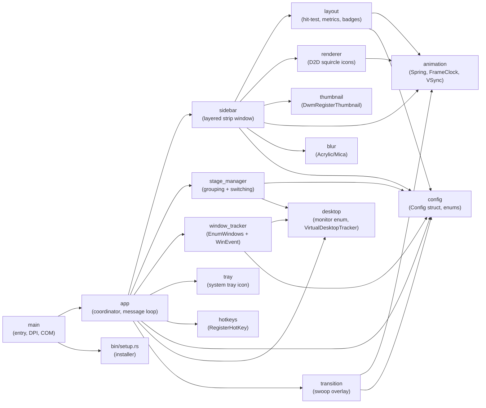
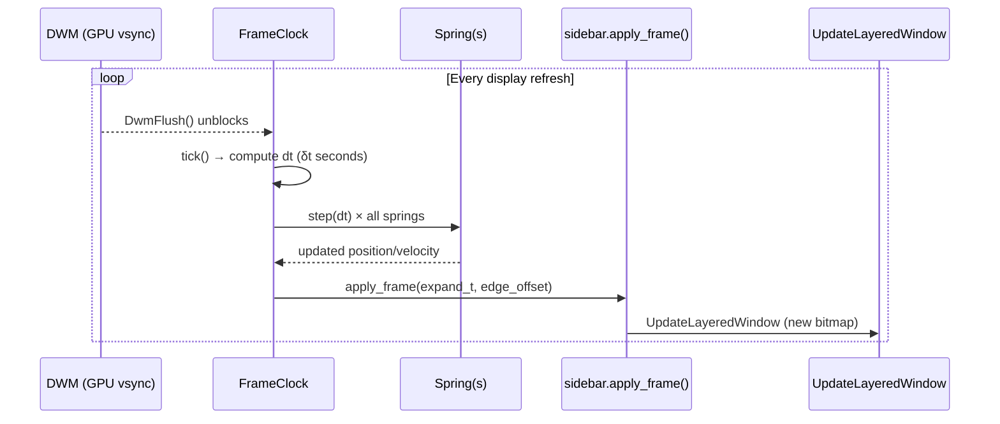
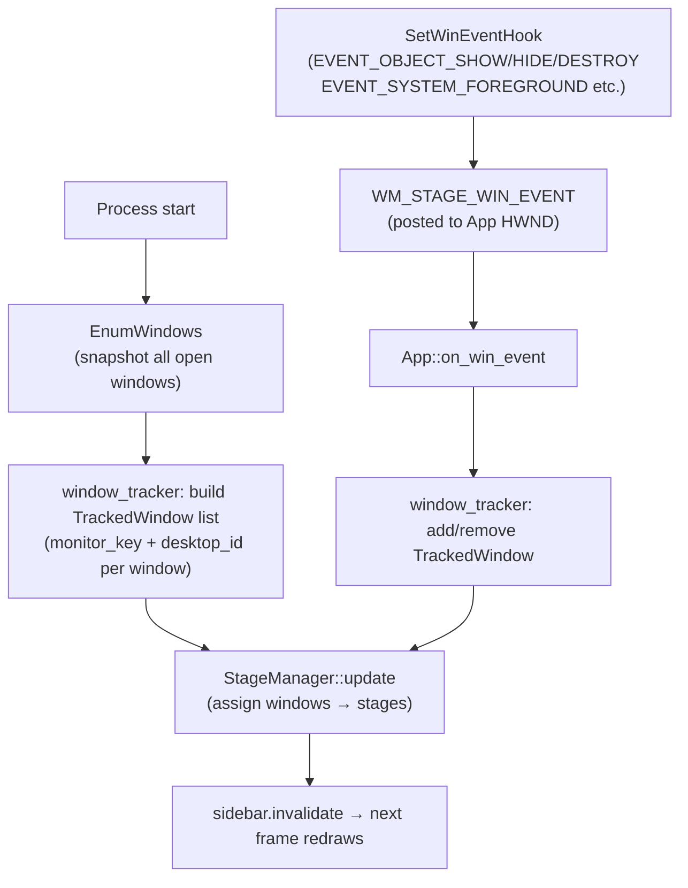
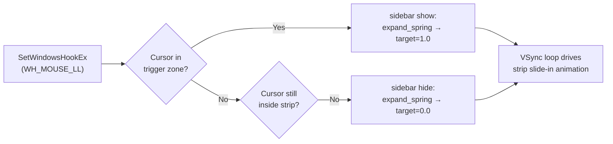
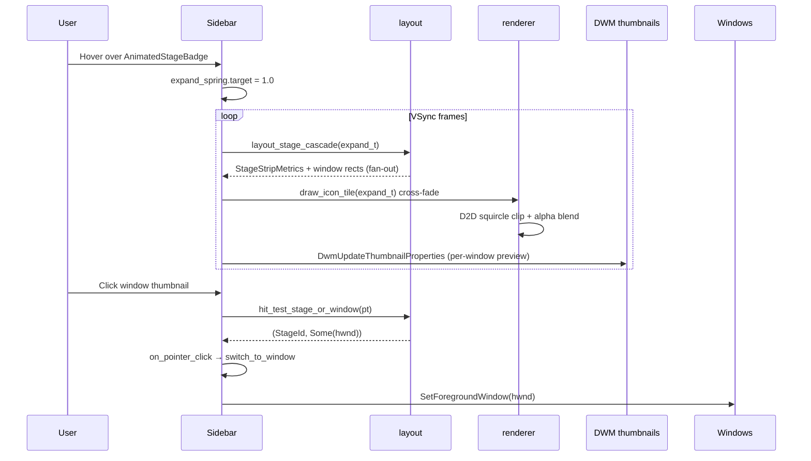
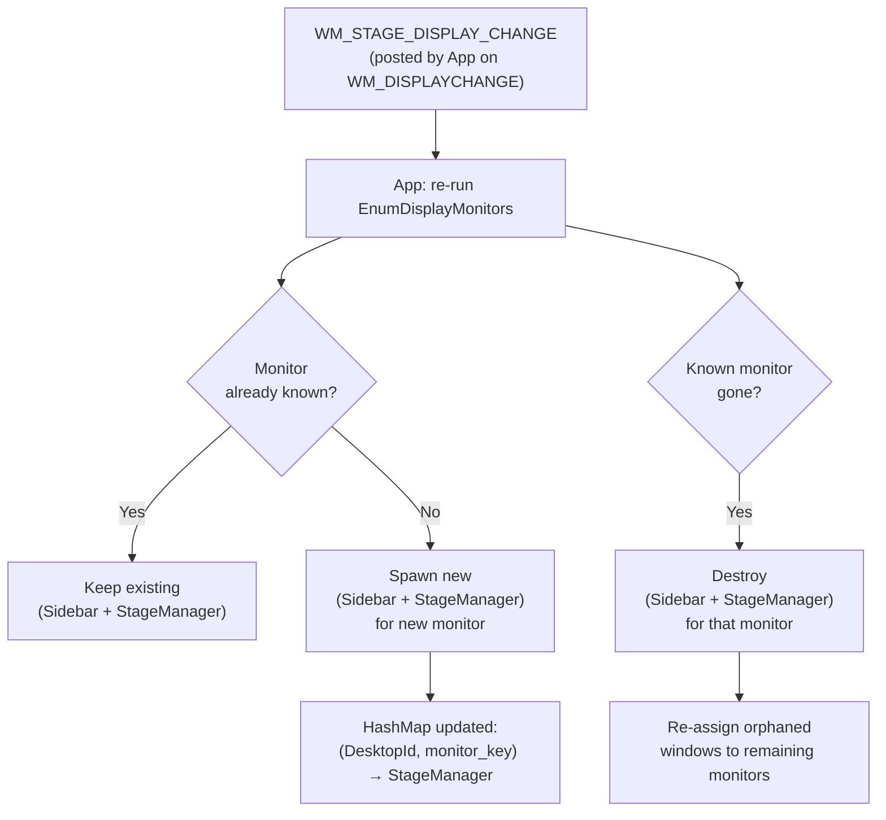
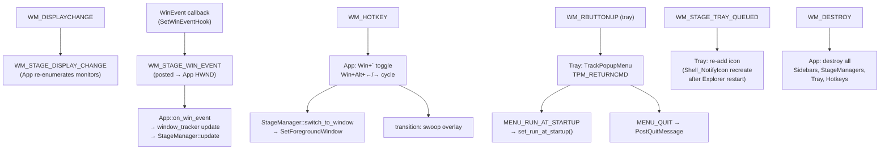

# Stage Manager — Architecture Reference

## Overview

Stage Manager is a Windows desktop productivity utility that replicates macOS-style "Stage Manager" window grouping directly on Windows 10/11. It presents a **floating sidebar strip** on one edge of each monitor where open windows are organized into *stages* (groups). Clicking a stage brings all its windows to the foreground; hovering expands a fan-out preview with individual window thumbnails. The application is written in **Rust**, targeting Win32 and Direct2D APIs, and relies heavily on:

- **Win32 windowing** (layered windows via `UpdateLayeredWindow`, window enumeration, `WinEvent` hooks)
- **DWM** (`DwmRegisterThumbnail`, `DwmFlush`-based VSync, `DwmSetWindowAttribute` for Acrylic/Mica blur)
- **Direct2D** (squircle icon rendering)
- **COM** (`IVirtualDesktopManager` for virtual-desktop isolation, `IShellLinkW` for installer shortcuts)
- A **spring-physics animation system** synchronized to the display's VSync via `DwmFlush`

The main binary runs as a single-instance process (guarded by `CreateMutexW`), sets per-monitor DPI awareness, initializes COM, then hands control to `App` which owns a Win32 message loop and one `(Sidebar + StageManager)` pair per monitor per virtual desktop.

---

## Module Dependency Graph



---

## Key Data Flows

### 1. VSync / Animation Frame Loop



> [!NOTE]
> `DwmFlush()` blocks the VSync thread until the next display refresh, giving a hardware-timed heartbeat. `FrameClock` measures wall-clock delta between successive flushes to feed the spring integrator, keeping animation velocity frame-rate-independent.

---

### 2. Window Discovery & Tracking



---

### 3. Mouse Trigger — Sidebar Show / Hide



---

### 4. Stage Group Expand & Icon Render



---

### 5. Multi-Monitor Hotplug



---

## Module Reference

| Module | Purpose | Key Types / Functions |
|---|---|---|
| `animation` | Spring-physics engine + VSync heartbeat | `Spring`, `SpringRect`, `FrameClock`, `VsyncTicker`, `DwmFlush` wrapper |
| `app` | Root coordinator; owns message loop and all per-monitor workspaces | `App`, `HashMap<(DesktopId, monitor_key), StageManager>`, `WM_STAGE_DISPLAY_CHANGE`, `WM_STAGE_TRAY_QUEUED` |
| `blur` | Windows 11 backdrop blur via DWM attributes | `GlassTheme` enum, `apply_blur(hwnd, theme)` |
| `config` | Serialized user settings; shared across all modules | `Config`, `SidebarEdge`, `TriggerMode`, `GroupingMode` |
| `desktop` | Monitor enumeration + virtual desktop COM wrapper | `enumerate_monitors`, `monitor_for_window`, `VirtualDesktopTracker`, `is_run_at_startup_enabled`, `set_run_at_startup` |
| `hotkeys` | Global keyboard shortcuts | `register_hotkeys(hwnd)`, Win+`` ` `` toggle, Win+Alt+←/→ cycle |
| `layout` | Spatial metrics, hit-testing, badge animation | `layout_stage_cascade`, `StageStripMetrics`, `hit_test_stage_or_window`, `AnimatedStageBadge`, `expand_t`, `lerp_i32` |
| `renderer` | Direct2D layered-window painting | `draw_icon_tile`, squircle clip, cluster↔individual cross-fade |
| `sidebar` | Per-monitor floating strip window | `Sidebar`, `StageAnimState`, `expand_spring`, `is_cursor_inside`, `on_pointer_click`, `new_for_monitor`, `MonitorInfo` |
| `stage_manager` | Window-to-stage grouping & activation | `Stage`, `StageId`, `StageManager`, `switch_to_window` |
| `thumbnail` | DWM live thumbnail links | `ThumbnailLink`, `DwmRegisterThumbnail`, `DwmUpdateThumbnailProperties` |
| `transition` | Animated swoop overlay on stage switch | `Transition`, spring-driven overlay HWND |
| `tray` | System tray icon + context menu | `Tray`, `create_stage_manager_hicon` (32 px ARGB squircle), `TPM_RETURNCMD`, `owned_hicon` drop cleanup |
| `window_tracker` | Live catalogue of manageable windows | `TrackedWindow`, `EnumWindows`, `SetWinEventHook`, `monitor_key`, `desktop_id`, own-PID filter |
| `main` | Entry point: DPI, COM, mutex guard | `SetProcessDpiAwarenessContext`, `CoInitializeEx`, `CreateMutexW` |
| `bin/setup.rs` | Standalone installer / uninstaller | Registry entries, `IShellLinkW` Start Menu shortcut, uninstaller registration, `--silent`/`--uninstall` flags |

---

## Animation Loop — VSync Frame Budget

The sidebar is a **layered window** (no child controls, fully owner-drawn). Every frame must:

1. **`DwmFlush()`** — block until next VSync (~16.6 ms at 60 Hz, ~6.9 ms at 144 Hz).
2. **`FrameClock::tick()`** — compute `dt` from wall clock; clamp to ≤ 50 ms to prevent spiral-of-death after app pause.
3. **Spring integration** — `O(n)` over all active springs (`expand_spring`, per-badge `expand_t`, `edge_offset_spring`).  Harmonic oscillator: `a = −stiffness×(x − target) − damping×v`.
4. **Layout pass** — `layout_stage_cascade` recalculates badge positions from new `expand_t` values.  Pure math, no Win32 calls.
5. **Render pass** — `draw_icon_tile` composites a fresh ARGB bitmap using Direct2D onto a GDI-compatible DC.
6. **`UpdateLayeredWindow()`** — uploads the new bitmap to DWM in one call; DWM composites it at the next flip.

> [!TIP]
> Steps 3–5 run entirely in user space on the VSync thread. The goal is to finish all three in well under one frame period so the bitmap is ready for `UpdateLayeredWindow` before DWM needs it. Keeping `layout_stage_cascade` allocation-free and renderer state pre-warmed is critical for smooth 144 Hz operation.

---

## Multi-Monitor & Virtual Desktop Isolation

```
HashMap<(DesktopId, monitor_key), StageManager>
```

- **`monitor_key`** — a `u64` derived from `HMONITOR` (stable within a session, recalculated on `WM_STAGE_DISPLAY_CHANGE`).
- **`DesktopId`** — the GUID returned by `IVirtualDesktopManager::GetWindowDesktopId`.
- Each `(desktop, monitor)` pair has its **own** `StageManager` and `Sidebar`, so stages on Desktop 2 / Monitor 1 are completely invisible when you are on Desktop 1 / Monitor 1.
- `VirtualDesktopTracker` caches GUID → index mappings (the COM interface does not provide ordering, only identity) and invalidates on `WM_STAGE_DISPLAY_CHANGE`.
- When a window moves to a different virtual desktop, `window_tracker` re-queries its `desktop_id` and fires a synthetic update so `StageManager::update` can migrate it to the correct bucket.
- Monitor hotplug is handled by `WM_STAGE_DISPLAY_CHANGE` (a private message App posts to itself on `WM_DISPLAYCHANGE`): new monitors get a fresh pair; removed monitors have their pair destroyed and their windows re-homed.

---

## Win32 Message Flow



> [!IMPORTANT]
> `WinEvent` hooks fire on the thread that called `SetWinEventHook`. To keep the hook callback short and avoid re-entrancy with the message loop, Stage Manager **posts** `WM_STAGE_WIN_EVENT` to the App HWND rather than processing inline. This ensures all state mutation happens serially on the main thread.
