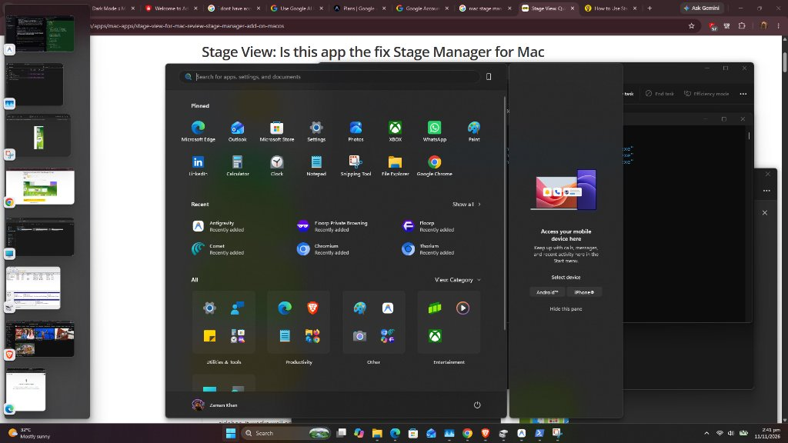

# Introduction

**Stage Manager for Windows** brings the visual, stage-based multitasking interface of macOS to Windows 10 and 11 as a high-performance native Rust application.

Unlike screenshot-polling utilities or heavy web-based shells, Stage Manager links directly into the Windows Desktop Window Manager (DWM) hardware compositor and uses second-order damped spring physics paced to the display's vertical blank (`DwmFlush`) for fluid 60Hz and 120Hz high-refresh animations.

---

## Why Stage Manager for Windows?

Traditional Windows multitasking relies on crowded taskbars and flat `Alt + Tab` grids that can quickly become cluttered when working with multiple projects or browser tabs. Stage Manager re-imagines your desktop as a collection of focused **Stages**:

- **Fewer Distractions:** Your active work stays centered on the screen, while inactive workspaces float quietly on the side.
- **Hardware-Accelerated Compositing:** Previews are rendered directly by the GPU compositor (`DwmRegisterThumbnail`) — zero CPU screenshot polling.
- **Sub-Megabyte Footprint:** Compiles to a self-contained ~540 KB executable using under 20 MB of system RAM.
- **True Multi-Screen Isolation:** Each connected monitor manages its own independent stage strip, trigger sensor, and DPI scaling.
