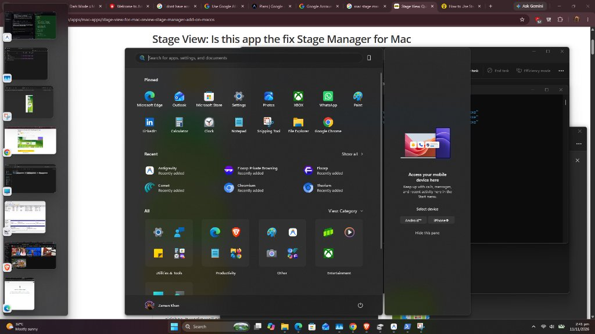

# Welcome to the Stage Manager for Windows Wiki

**Stage Manager for Windows** brings the intuitive, visual stage-based multitasking interface of macOS to Windows 10 and 11 as a high-performance native Rust application.

Unlike screenshot-polling utilities or heavy web-based shells, Stage Manager links directly into the Windows Desktop Window Manager (DWM) hardware compositor and uses second-order damped spring physics paced to the display's vertical blank (`DwmFlush`) for fluid 60Hz and 120Hz high-refresh animations.

---

## Quick Navigation

| Guide | Description |
|---|---|
| [**Getting Started**](Getting-Started) | Download, installation via `winget`/git clone, first launch, and system tray setup |
| [**Core Concepts**](Core-Concepts) | Understanding stages, window groups, active workspace handoff, and stage isolation |
| [**Keyboard Shortcuts**](Keyboard-Shortcuts) | Global hotkeys, modifier clicks (`Shift + Click` merge), and mouse trigger zones |
| [**Configuration Guide**](Configuration-Guide) | Complete reference of all runtime settings, glass themes (Acrylic/Mica), and startup registry |
| [**Multi-Monitor & Virtual Desktops**](Multi-Monitor-and-Virtual-Desktops) | Per-monitor strip isolation, display hotplug events, and `IVirtualDesktopManager` integration |
| [**Architecture & Internals**](Architecture-and-Internals) | 13-module map, thread model, WinEvent routing, and hardware synchronization |
| [**DWM Thumbnails & Direct2D**](DWM-Thumbnails-and-Direct2D) | Low-level DWM compositing, layered windows, and vector squircle badge rendering |
| [**Troubleshooting & FAQ**](Troubleshooting-and-FAQ) | Common questions, single-instance mutex, and Explorer restart recovery |

---

## Architectural Highlights

- **Hardware Compositor Integration:** Direct `DwmRegisterThumbnail` links with destination clipping rects — zero CPU screenshot polling.
- **Fluid Spring Physics:** Real-time second-order spring dynamics with curve-wave inward bending and hover pop.
- **Group Fan-Out:** Hovering over multi-window stages fans out cards horizontally with per-window Direct2D squircle badges.
- **Infinite Carousel:** Continuous vertical scrolling with seamless wrap-around at screen edges.
- **Per-Monitor Independent Workspaces:** Each monitor runs its own isolated Stage Manager strip with per-monitor DPI scaling.
- **Windows Virtual Desktop Isolation:** Full isolation per virtual desktop GUID via `IVirtualDesktopManager`.
- **Tiny Footprint:** Single portable executable under 600 KB using under 20 MB RAM.
